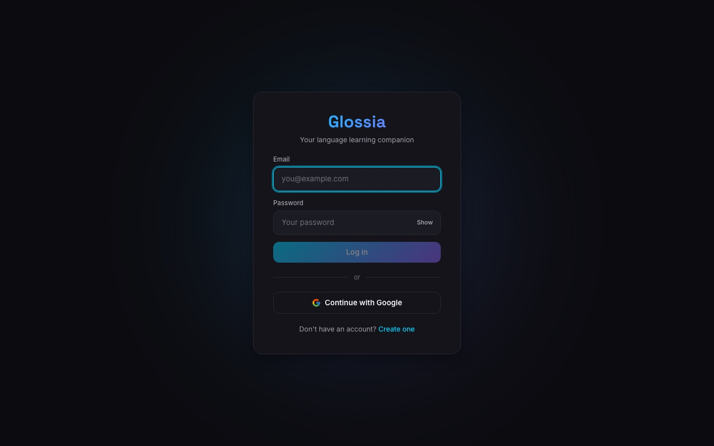

# Glossia

[](https://github.com/JKs162426/glossia-v2/actions/workflows/ci.yml)

A language-learning app: a guided A1–A2 learning path, flashcards, a translator
and saved favorites, in 8 languages (EN, ES, FR, DE, IT, PT, RU, ZH).

**Live:** <https://glossia-v2.onrender.com> — hosted on Render's free tier, so
the first load can take up to a minute while the server wakes up.

[](https://glossia-v2.onrender.com)

## Features

- **Learning path** — A1 and A2 units with lessons that unlock in order
- **Flashcards** by category, with progress tracking
- **Translator** powered by the [MyMemory](https://mymemory.translated.net) API
- **Favorites** — save words and phrases to review later
- **Accounts** with email/password or Google sign-in
- **Animations with a purpose**: unlocking the next lesson, right and wrong
  answers, rewards and the streak. All of them stop with the system's
  "reduce motion" setting.

## Stack

| Layer | Tech |
| --- | --- |
| Frontend (`client/`) | React 19, React Router, Vite, Axios |
| Backend (`server/`) | Node.js, Express 5, express-validator |
| Database | MySQL (`mysql2`), SQL migrations |
| Auth | JWT in an httpOnly cookie, bcrypt, Passport (Google OAuth 2.0) |
| Security | helmet, express-rate-limit |
| Tests | Vitest, Supertest, Testing Library (jsdom), Playwright (end-to-end) |
| Deploy | Render |

## Requirements

- **Node.js 22.13 or newer** (`engine-strict` is on, so npm refuses
  packages that need a newer Node than you have)
- **MySQL 8** or newer
- **Google Chrome**, only for the end-to-end tests

## Setup

```bash
# 1. API
cd server
cp .env.example .env       # fill in DB credentials and generate the secrets
npm install
npm run migrate            # creates/updates the schema and seeds flashcards
npm run dev                # http://localhost:3000

# 2. Client (another terminal)
cd client
npm install
npm run dev                # http://localhost:5173
```

Google sign-in is optional: set `GOOGLE_CLIENT_ID` / `GOOGLE_CLIENT_SECRET` and
register `http://localhost:3000/api/auth/google/callback` as a redirect URI.

## Environment variables

`server/.env` (production values live only in Render, never in the repo):

| Variable | Purpose |
| --- | --- |
| `PORT` | Port the API listens on (Render sets it) |
| `NODE_ENV` | `development`, `production` or `test` |
| `CLIENT_URL` | Allowed origin for CORS in development |
| `TRUST_PROXY_HOPS` | Proxies in front of the app in production — **3 on Render** |
| `DB_HOST`, `DB_PORT`, `DB_USER`, `DB_PASSWORD`, `DB_NAME` | MySQL connection |
| `DB_SSL_CA` | CA certificate for TLS to managed MySQL (Aiven) |
| `JWT_SECRET` | Signs session tokens; required, 32+ chars in production |
| `JWT_EXPIRES_IN` | Session length (default `7d`) |
| `GOOGLE_CLIENT_ID`, `GOOGLE_CLIENT_SECRET`, `GOOGLE_CALLBACK_URL` | Optional Google sign-in |

`client/.env` (development only): `VITE_API_URL` — the API base URL.

## Tests

```bash
# Server — needs a MySQL server for the integration group
cd server
cp .env.test.example .env.test   # point DB_* at your MySQL; DB_NAME must end in _test
npm test                         # unit + integration
npm run test:unit                # no database needed
npm run test:integration         # creates glossia_test and applies all migrations first
npm run lint

# Client
cd client
npm test
npm run lint

# End-to-end — needs server/.env.test (same MySQL as above), the client's and
# the server's npm install, and Google Chrome
cd e2e
npm install
npm test                         # builds the client, starts the API on :3300, runs the flows
npm run test:headed              # same, watching the browser
npm run lint
```

- **Unit** (`server/tests/unit`, `client/src/**/*.test.{js,jsx}`): logic and
  components, no database. They cover:
  - path unlocking (A2 stays locked until A1 is done) and no repeated word per level;
  - stars, XP, the streak and the 7-day chart;
  - the Google OAuth `state` check and the JWT (HS256 only, expired or edited
    tokens rejected, httpOnly cookie);
  - typed-answer checking (articles, accents, case, `l'`) and exercise building
    (12 per lesson, 11 per checkpoint, 4 different options);
  - bad requests: invalid JSON → 400 and bodies over 20 KB → 413, with no
    internal details in any error response;
  - animations: which nodes the path celebrates after a lesson (and that a
    reload doesn't replay it), the speaker icon while a word is spoken, the
    count-up and the streak "+1".
- **Integration** (`server/tests/integration`): the real API against a MySQL
  test database. Before the run, `globalSetup.js` creates the database and
  applies every migration, exactly like production. They cover:
  - register and login (httpOnly cookie, weak password → 400, repeated email
    → 409, the same message for a wrong password or an unknown email, the 11th
    failed login → 429), `/me` and logout;
  - authorization: another user's favorites can't be listed or deleted (404),
    locked lessons answer 403;
  - completing a lesson saves the best score, stars and XP and unlocks the next one.
- Each integration test cleans up after itself: `tests/integration/setup.js`
  deletes the users it created (emails on `tests.glossia.dev`), and their data
  goes with them through `ON DELETE CASCADE`. `helpers.js` has
  `createTestUser()`, which returns a user with a ready session cookie.
- **End-to-end** (`e2e/tests`): Playwright drives Google Chrome through the
  real app (the built client served by the API on port 3300, on the test
  database, with animations off). They cover:
  - a new learner registers, finishes the first lesson with no mistakes, sees
    the next lesson unlocked, and the dashboard shows the XP, streak and words;
  - flashcards with the keyboard (Space, ←, →), the missed words and
    "Practice missed";
  - the translator → save a favorite → it shows up in Favorites → remove it.
    The test answers the MyMemory requests itself, so it never calls the
    real service;
  - logging out, every protected page redirecting to the login, and logging
    back in returns to the page that was asked for;
  - the dashboard and the learning path on a 390 px phone: nothing past the
    screen edges, nothing hidden behind the top bar or the bottom nav, and
    touch targets of at least 44 px;
  - accessibility: [axe](https://github.com/dequelabs/axe-core-npm) runs its
    automatic WCAG 2.2 A and AA checks on the main pages. Automatic checks
    catch part of the problems, not all: keyboard and screen reader use
    still need a person.

  Any error in the browser console fails the test. Each test deletes only the
  users it created, so the tests run in parallel. If port 3300 is busy the run
  stops instead of testing whatever is running there.
- With `NODE_ENV=test` the server reads **only** `server/.env.test` and refuses
  any database whose name doesn't end in `_test`, so tests can't touch real data.

### Continuous integration

Every push and pull request runs three jobs on GitHub Actions
(`.github/workflows/ci.yml`):

| Job | Runs |
| --- | --- |
| Client | lint, unit tests, `npm audit` |
| Server | lint, unit and integration tests against a MySQL 8.4 service, `npm audit` |
| End-to-end | lint, the Playwright tests in Google Chrome, on their own MySQL service |

- `npm audit` fails the job on high or critical issues in the packages that
  ship (`--omit=dev`).
- When an end-to-end test fails, the run keeps its trace for 7 days
  (`playwright-traces`): open it with `npx playwright show-trace trace.zip`.
- `main` is protected: a commit can only land there once all three jobs pass.
- Dependabot (`.github/dependabot.yml`) opens pull requests every Monday for
  the npm packages and the GitHub Actions, only for versions released at
  least a week earlier.

## Project structure

```
client/                React app (Vite)
  src/pages/           One component per screen (Home, Learn, Lesson, …)
  src/components/      Shared UI: Sidebar, Icon (own SVG set), AuthShell…
  src/lib/             Pure logic: exercises, languages, icons, speech,
                       path celebrations, streak memory
  src/hooks/           useApi (GET a path), useCountUp (animated numbers)
  src/test/setup.js    Test setup (DOM matchers)
server/
  src/app.js           Builds the Express app (exported, used by tests)
  src/server.js        Entry point: opens the port
  src/routes/ → controllers/ → models/   Request path, layer by layer
  src/services/        Pure logic: curriculum (path order, unlocking),
                       scoring (stars, XP), activity (streak, week)
  src/data/            Lesson content in all 8 languages
  src/db/              Migration runner (npm run migrate)
  db/migrations/       Versioned SQL schema and seed data
  tests/               unit/ and integration/ test suites
.github/               CI workflow and Dependabot settings
e2e/                   End-to-end tests (Playwright)
  tests/               One file per user flow, plus mobile and accessibility
  fixtures.js          Logged-in user, cleanup, console-error check
```

## How it fits together

| Area | Where |
| --- | --- |
| Learning path content (A1/A2, every language) | `server/src/data/curriculum.js` |
| Path order, unlocking, lesson ids | `server/src/services/curriculumService.js` |
| Stars and XP for a finished lesson | `server/src/services/scoringService.js` |
| Streak and the 7-day XP chart | `server/src/services/activityService.js` |
| Exercise generation & answer checking | `client/src/lib/exercises.js` |
| Animations | Shared keyframes and the reduce-motion rule in `client/src/index.css`, icon animations in `components/Icon.css`, the rest in each page's CSS. `lib/path.js` decides what the path celebrates. |
| Database migrations | `server/db/migrations/*.sql` (`npm run migrate`) |
| Supported languages | `server/src/config/languages.js` + `client/src/lib/languages.js` (keep in sync) |

### Data flow

1. The React app calls the API under `/api` with the session cookie.
2. Each request goes through rate limit → JWT check (`middleware/auth.js`) →
   validation (`middleware/validators.js`) → controller → model (parameterized SQL).
3. Lesson content comes from `curriculum.js`; progress is stored in MySQL
   (`lesson_progress`, `flashcard_progress`, `activity_days`).
4. The dashboard reads it back in one call: `GET /api/stats/overview`.

### Auth & security

- Sessions are a JWT in an **httpOnly, SameSite=Lax cookie** (not localStorage),
  so scripts on the page can't read it.
- Passwords: bcrypt (12 rounds), min 8 chars with a letter and a number.
- Rate limits on login/register and on the whole API; security headers via helmet.
  Limits are counted per client IP, so in production `TRUST_PROXY_HOPS` must
  match the number of proxies in front of the app — **3 on Render**. To check
  it, the `pk` in the `RateLimit-Policy` header must equal the base64 of the
  first 12 hex chars of `sha256(your IP)`, and must not change when you send a
  fake `X-Forwarded-For`.
- Google OAuth uses the `state` parameter (kept in a short-lived cookie) and never puts tokens in URLs.
- The API refuses to start without `JWT_SECRET`.

### Adding a lesson

Add an entry to a unit's `lessons` in `curriculum.js` with the word in all 8
languages. The server checks at startup that no level repeats a word in the
same language.

## Deployment

Render runs one web service that serves both the built React app and the API
(same origin, so the session cookie stays first-party). Every push to `main`:

1. builds the client (`vite build`) and installs the server,
2. runs `npm run migrate` (pending migrations only), then `npm start`,
3. switches traffic once `GET /api/health` responds.

The database is MySQL on Aiven, reached over TLS (`DB_SSL_CA`).

## Author

Built by [Jesus Figueroa](https://jfigueroa.dev) · [GitHub](https://github.com/JKs162426)
