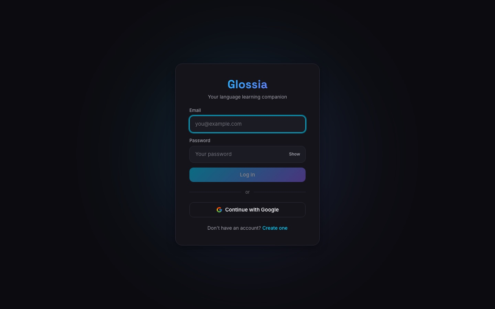

# Glossia

A language-learning app: a guided A1–A2 learning path, flashcards, a translator
and saved favorites, in 8 languages (EN, ES, FR, DE, IT, PT, RU, ZH).

**Live:** <https://glossia-v2.onrender.com> — hosted on Render's free tier, so
the first load can take up to a minute while the server wakes up.

[](https://glossia-v2.onrender.com)

## Features

- **Learning path** — A1 and A2 units with lessons that unlock in order
- **Flashcards** by category, with progress tracking
- **Translator** powered by the [MyMemory](https://mymemory.translated.net) API
- **Favorites** — save words and phrases to review later
- **Accounts** with email/password or Google sign-in

## Stack

| Layer | Tech |
| --- | --- |
| Frontend (`client/`) | React 19, React Router, Vite, Axios |
| Backend (`server/`) | Node.js, Express 5, express-validator |
| Database | MySQL (`mysql2`), SQL migrations |
| Auth | JWT in an httpOnly cookie, bcrypt, Passport (Google OAuth 2.0) |
| Security | helmet, express-rate-limit |
| Tests | Vitest, Supertest, Testing Library (jsdom) |
| Deploy | Render |

## Requirements

- **Node.js 22.13 or newer** (`engine-strict` is on, so npm refuses
  packages that need a newer Node than you have)
- **MySQL 8** or newer

## Setup

```bash
# 1. API
cd server
cp .env.example .env       # fill in DB credentials and generate the secrets
npm install
npm run migrate            # creates/updates the schema and seeds flashcards
npm run dev                # http://localhost:3000

# 2. Client (another terminal)
cd client
npm install
npm run dev                # http://localhost:5173
```

Google sign-in is optional: set `GOOGLE_CLIENT_ID` / `GOOGLE_CLIENT_SECRET` and
register `http://localhost:3000/api/auth/google/callback` as a redirect URI.

## Environment variables

`server/.env` (production values live only in Render, never in the repo):

| Variable | Purpose |
| --- | --- |
| `PORT` | Port the API listens on (Render sets it) |
| `NODE_ENV` | `development`, `production` or `test` |
| `CLIENT_URL` | Allowed origin for CORS in development |
| `TRUST_PROXY_HOPS` | Proxies in front of the app in production — **3 on Render** |
| `DB_HOST`, `DB_PORT`, `DB_USER`, `DB_PASSWORD`, `DB_NAME` | MySQL connection |
| `DB_SSL_CA` | CA certificate for TLS to managed MySQL (Aiven) |
| `JWT_SECRET` | Signs session tokens; required, 32+ chars in production |
| `JWT_EXPIRES_IN` | Session length (default `7d`) |
| `GOOGLE_CLIENT_ID`, `GOOGLE_CLIENT_SECRET`, `GOOGLE_CALLBACK_URL` | Optional Google sign-in |

`client/.env` (development only): `VITE_API_URL` — the API base URL.

## Tests

```bash
# Server — needs a MySQL server for the integration group
cd server
cp .env.test.example .env.test   # point DB_* at your MySQL; DB_NAME must end in _test
npm test                         # unit + integration
npm run test:unit                # no database needed
npm run test:integration         # creates glossia_test and applies all migrations first
npm run lint

# Client
cd client
npm test
npm run lint
```

- **Unit** (`server/tests/unit`, `client/src/**/*.test.jsx`): logic and
  components, no database.
- **Integration** (`server/tests/integration`): the real API against a MySQL
  test database. Before the run, `globalSetup.js` creates the database and
  applies every migration, exactly like production.
- With `NODE_ENV=test` the server reads **only** `server/.env.test` and refuses
  any database whose name doesn't end in `_test`, so tests can't touch real data.

## Project structure

```
client/                React app (Vite)
  src/pages/           One component per screen (Home, Learn, Lesson, …)
  src/components/      Shared UI: Sidebar, Icon (own SVG set), AuthShell…
  src/lib/             Pure logic: exercises, languages, icons, speech
  src/test/setup.js    Test setup (DOM matchers)
server/
  src/app.js           Builds the Express app (exported, used by tests)
  src/server.js        Entry point: opens the port
  src/routes/ → controllers/ → models/   Request path, layer by layer
  src/services/        Curriculum logic (path order, unlocking)
  src/data/            Lesson content in all 8 languages
  src/db/              Migration runner (npm run migrate)
  db/migrations/       Versioned SQL schema and seed data
  tests/               unit/ and integration/ test suites
```

## How it fits together

| Area | Where |
| --- | --- |
| Learning path content (A1/A2, every language) | `server/src/data/curriculum.js` |
| Path order, unlocking, lesson ids | `server/src/services/curriculumService.js` |
| Exercise generation & answer checking | `client/src/lib/exercises.js` |
| Database migrations | `server/db/migrations/*.sql` (`npm run migrate`) |
| Supported languages | `server/src/config/languages.js` + `client/src/lib/languages.js` (keep in sync) |

### Data flow

1. The React app calls the API under `/api` with the session cookie.
2. Each request goes through rate limit → JWT check (`middleware/auth.js`) →
   validation (`middleware/validators.js`) → controller → model (parameterized SQL).
3. Lesson content comes from `curriculum.js`; progress is stored in MySQL
   (`lesson_progress`, `flashcard_progress`, `activity_days`).
4. The dashboard reads it back in one call: `GET /api/stats/overview`.

### Auth & security

- Sessions are a JWT in an **httpOnly, SameSite=Lax cookie** (not localStorage),
  so scripts on the page can't read it.
- Passwords: bcrypt (12 rounds), min 8 chars with a letter and a number.
- Rate limits on login/register and on the whole API; security headers via helmet.
  Limits are counted per client IP, so in production `TRUST_PROXY_HOPS` must
  match the number of proxies in front of the app — **3 on Render**. To check
  it, the `pk` in the `RateLimit-Policy` header must equal the base64 of the
  first 12 hex chars of `sha256(your IP)`, and must not change when you send a
  fake `X-Forwarded-For`.
- Google OAuth uses the `state` parameter (kept in a short-lived cookie) and never puts tokens in URLs.
- The API refuses to start without `JWT_SECRET`.

### Adding a lesson

Add an entry to a unit's `lessons` in `curriculum.js` with the word in all 8
languages. The server checks at startup that no level repeats a word in the
same language.

## Deployment

Render runs one web service that serves both the built React app and the API
(same origin, so the session cookie stays first-party). Every push to `main`:

1. builds the client (`vite build`) and installs the server,
2. runs `npm run migrate` (pending migrations only), then `npm start`,
3. switches traffic once `GET /api/health` responds.

The database is MySQL on Aiven, reached over TLS (`DB_SSL_CA`).

## Author

Built by [Jesus Figueroa](https://jfigueroa.dev) · [GitHub](https://github.com/JKs162426)
